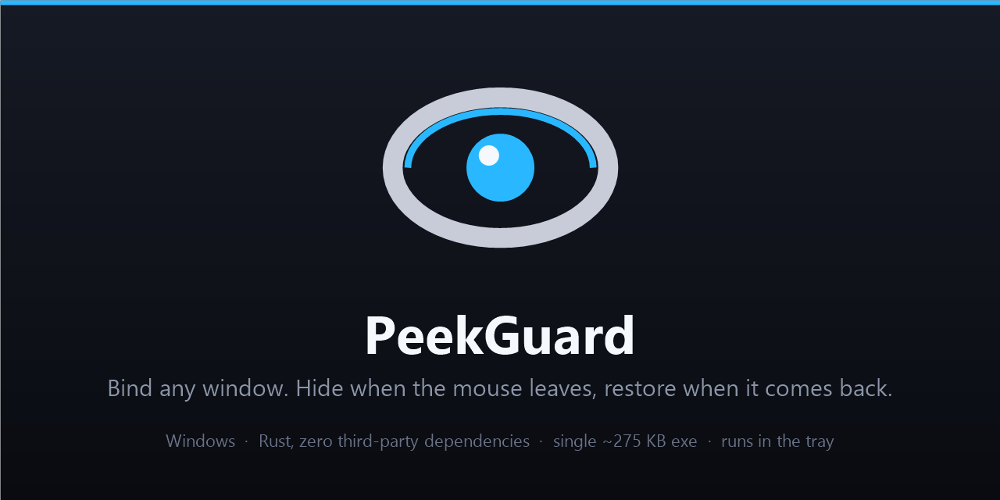

# PeekGuard

English | [简体中文](README.zh-CN.md)

[](https://github.com/Reance195/peekguard/actions/workflows/ci.yml)
[](LICENSE)

<p align="center">
  
</p>

Bind any window. The mouse leaves — it disappears. The mouse comes back — it returns.

This is the behaviour of QQ's "privacy peek window" in China, applied to *any* window
instead of just QQ.

```
cursor inside the window      350 ms after it left         cursor returns
┌──────────────┐           ┌──────────────┐           ┌──────────────┐
│  chat window  │   ────>   │  fully clear  │   ────>   │  chat window  │
│  as normal    │           │  nothing on   │           │  back to      │
│               │           │  screen       │           │  normal       │
└──────────────┘           └──────────────┘           └──────────────┘
```

- **Zero dependencies** — standard library and hand-written Win32 / X11 / macOS
  (CoreGraphics + Accessibility) FFI only. Nothing from crates.io.
- **One file** — a ~380 KB exe on Windows, no installer, lives in the tray; a plain
  binary on Linux and macOS, driven by hotkeys and IPC.
- **Zero intrusion** — no injection, no subclassing, no global hooks. The target
  process is never touched.
- **Never leaves a mess** — a crash, a task-manager kill, or an abnormal exit all get
  your windows restored on the next launch.
- **Standing rules** — write one `rule =` line and PeekGuard figures out which windows
  to protect on its own.

> Windows (x86_64), Linux (X11, WSLg included) and macOS (Apple silicon; needs the Accessibility grant).

## Download

Grab `peekguard.exe` (Windows) from the [Releases](../../releases). Run it — there is
nothing to install. Linux and macOS build from source (see below); no prebuilt package yet.

## Build from source

Requires Rust 1.87 or newer (the code uses `is_multiple_of`):

```sh
git clone https://github.com/Reance195/peekguard.git
cd peekguard
cargo build --release      # Windows -> target/release/peekguard.exe
                           # Linux/macOS -> target/release/peekguard
```

On Windows a default config is written to `%APPDATA%\PeekGuard\peekguard.conf` on first
run, and PeekGuard then sits in the tray; it has no main window.

On Linux the binary `dlopen`s the system's `libX11.so.6` at runtime — zero link
dependencies, and no `-dev` package needed. The config lives in
`~/.config/peekguard/peekguard.conf` (XDG).

On macOS the build links the system frameworks directly (CoreGraphics, Accessibility,
Carbon) — still zero crates and no build script. The config lives in
`~/Library/Application Support/PeekGuard/peekguard.conf`.

## Linux (X11)

The Linux build behaves like the Windows one: bind a window, it hides when the mouse
leaves and comes back when it returns — same hotkeys, same three hide strategies. What
it does **not** have is a system tray; control moves to hotkeys, desktop notifications
and local IPC:

- Hotkeys are unchanged: `Ctrl+Alt+P` bind, `Ctrl+Alt+H` hide/restore, `Ctrl+Alt+L` latch.
- State and actions are available over a **Unix domain socket** IPC (default
  `$XDG_RUNTIME_DIR/peekguard-ipc.sock`, mode 0600 — only your user can connect). The
  protocol is identical to the Windows named pipe: one text command line in, one JSON
  line out. `PEEKGUARD_PIPE` points it elsewhere (a leading `/` means an absolute path).
  Quick test: `node utools-plugin/test-cli.js status`
- Messages go out as desktop notifications (`notify-send`).

Things to know:

- **Alpha mode needs a compositor** to be running; without one PeekGuard says so and
  refuses, so use "move" or "hide" instead.
- Config and autostart follow XDG: config in `~/.config/peekguard/`, autostart as a
  `.desktop` file in `~/.config/autostart/` (switch it with the IPC command
  `autostart on|off`).
- The update check shells out to the system `curl` (fails silently when it is missing;
  nothing else is affected).
- There is no UIPI on X11, so the elevated-target refusal does not apply; process names
  are read from `/proc`.

## macOS

The macOS build uses `Cmd+Option` instead of `Ctrl+Alt`: `Cmd+Option+P` bind,
`Cmd+Option+H` hide/restore, `Cmd+Option+L` latch. There is no tray, so control is
hotkeys plus the same Unix-socket IPC (`peekguard-ipc.sock` under `$XDG_RUNTIME_DIR`,
falling back to `TMPDIR` then `/tmp`).

Two hide strategies are available: "move" parks the window off the virtual screen with
an Accessibility position change, and "hide" minimizes it (`kAXMinimized`). There is no
public cross-app transparency API, so the alpha strategy is not offered here.

Window manipulation needs the **Accessibility** grant: System Settings → Privacy &
Security → Accessibility → tick PeekGuard. PeekGuard asks on first launch and warns while
the grant is missing; reads (geometry, titles, process names) work without it. Messages
go out via `osascript` notifications, autostart writes a LaunchAgent plist under
`~/Library/LaunchAgents/`, and the update check uses the system `curl`. Process names
come from `libproc`.

## Usage

| Action | Hotkey |
|---|---|
| Bind a window via crosshair picker | `Ctrl+Alt+P` |
| Hide / restore right now | `Ctrl+Alt+H` |
| Toggle latch mode | `Ctrl+Alt+L` |

All three can be rebound: click a chord in the uTools panel to record a new one
(Esc cancels), or edit `hotkey_bind` / `hotkey_toggle` / `hotkey_latch` in the
config and reload.

Tray icon (Windows; Linux and macOS have no tray — use the hotkeys and IPC instead):

- **Double-click** — bind a window via crosshair picker
- **Right-click** — full menu (hide strategy, rule auto-protection, delay, latch,
  save rule, run at login, reload config, quit)

### The usual flow

1. Switch to the window you want guarded (QQ, a browser, your stock app…)
2. Press `Ctrl+Alt+P` — a crosshair appears; highlight the target window and left-click to bind
3. Move the mouse away and the window hides; move back to the same spot and it returns
4. Make it permanent if you like it: on Windows, tray → "save the current binding as a
   standing rule"; on Linux and macOS, add a `rule =` line to the config — and every
   launch from now on is guarded automatically

## Three hide strategies

Cycle them from tray → "hide strategy".

| Strategy | How | Good for |
|---|---|---|
| **alpha** (default) | set the window to zero transparency | smoothest; the geometry is untouched on restore; enough to block the view next to you |
| **move** | shove the window off the virtual screen | the most thorough — even the Alt-Tab thumbnail shows nothing |
| **hide** | `ShowWindow(SW_HIDE)` | widest compatibility, at the cost of leaving a taskbar button |

> In alpha mode the window still accepts clicks. That is deliberate: you can keep
> using the window while it is invisible.

On Linux the three strategies map to `_NET_WM_WINDOW_OPACITY`, `XMoveWindow` (parked off
the virtual screen) and `XUnmapWindow`; alpha mode likewise needs a compositor.

On macOS two strategies are offered: "move" uses an Accessibility position change,
"hide" minimizes the window (`kAXMinimized`); alpha is not available on this platform.

## Latch mode

Toggle with `Ctrl+Alt+L`, or set `latch = true` in the config.

Once latched, a hidden window stays hidden even when the mouse comes back. Only
`Ctrl+Alt+H` or the tray menu will bring it back.

This is for the case where someone is already standing next to you. Otherwise you
move the mouse back and the window pops up in front of them.

## Standing rules (automatic protection)

Once you write a `rule =` line, PeekGuard rescans the window list once a second and
takes over any window that matches — **no manual binding, ever again**. Handy for
"QQ should always be guarded when it opens".

The scan picks one target per pass, in this order:

1. A match that is the foreground window wins — whatever you are looking at gets
   guarded first
2. Otherwise the topmost match in z-order
3. **Minimized windows are skipped.** They cannot be hidden at all, so parking the
   guard on one would leave every other match unprotected. A minimized window is
   reselected the moment it is restored, so skipping loses nothing.

A matched window gets a one-off "can you actually hide?" check up front. If it truly
refuses (typically an elevated target), PeekGuard says so once and remembers that
window — **no per-second retry spam**, and no hide/restore flapping.

> Two different things, on purpose: a window that gets *minimized after* being guarded
> keeps its binding (PeekGuard does not hop to another target); point 3 above is only
> about the scanner **choosing** a new target.

### Turning it off

Tray menu → "rule auto-protection", with a checkmark. Turning it off affects only the
rules — manual binding keeps working.

### What unbind actually means

This trips people up, so it is spelled out. Unbinding (`Ctrl+Alt+P`, or "unbind the
current window" from the menu) applies to **that one window** — it does not switch off
the rule:

| Action | The window you unbound | Later windows of the same kind |
|---|---|---|
| Unbind the current window | stays released; the rule does not take it back | guarded as usual |
| Turn "rule auto-protection" off in the menu | released immediately | unguarded until you turn it back on |
| Reload config | everything is recomputed | guarded as usual |

The reasoning: what you usually want is not "disable this rule" but "leave this one
alone". If unbinding also disabled the rule, unbinding QQ once would mean QQ is never
guarded again for the rest of the session — which is clearly not what anyone means.

## Run at login

On Windows: tray menu → "start with Windows", with a checkmark (read live from the
registry, not cached). It writes a single `PeekGuard` value under
`HKCU\Software\Microsoft\Windows\CurrentVersion\Run`, pointing at the full path of the
current exe (quoted, so spaces are fine). The registry rather than the Startup folder or
Task Scheduler: no elevation, no console window flash, no watchdog process.

If you move the exe the checkmark stays on (it matches by name) — untick and re-tick it
once to repoint it at the new location.

On Linux: an XDG autostart entry (a `.desktop` file in `~/.config/autostart/`), launched
by the desktop session at login. No tray item — switch it with the IPC command
`autostart on|off`.

On macOS: a LaunchAgent (`~/Library/LaunchAgents/PeekGuard.plist`), started by launchd
at login. Same IPC command `autostart on|off`.

## Configuration

Windows: `%APPDATA%\PeekGuard\peekguard.conf`. Linux:
`~/.config/peekguard/peekguard.conf` (XDG). macOS:
`~/Library/Application Support/PeekGuard/peekguard.conf`. Or point `PEEKGUARD_CONFIG`
somewhere else.
After editing, reload from the tray menu or with the IPC command `reload` (any platform).

```ini
# ms to wait after the cursor leaves before hiding (debounce, so a shaky
# mouse does not make the window flicker)
delay_ms = 350

# px of slack around the window rect when testing whether the cursor is inside
margin_px = 6

# hide strategy: alpha | move | hide
mode = alpha

# opacity used in alpha mode (0 = invisible)
alpha = 0

# true = stay hidden after hiding; restore manually
latch = false

# true = only react to the cursor while the target is the foreground window
hide_only_when_focused = false

# already-minimized windows are skipped
# deprecated: the behaviour is now unconditional (a minimized window cannot be
# hidden anyway). The key is kept so old configs do not warn; the value has no
# effect.
skip_minimized = true

# true = ask GitHub for a newer release on startup. This is the only thing in
# PeekGuard that ever touches the network; set it to false to stay fully offline.
check_update = true

# global hotkeys (modifiers Ctrl/Alt/Shift/Win; keys A-Z, 0-9, F1-F12)
hotkey_bind = Ctrl+Alt+P
hotkey_toggle = Ctrl+Alt+H
hotkey_latch = Ctrl+Alt+L

# windows bound automatically at startup (may be empty)
autobind =

# standing rules: automatically guard matching windows when they appear
# fields are separated by | ; inside title:, commas mean "or"
rule = process:QQ.exe
rule = process:msedge.exe | title:novel,stocks
```

Rule fields: `process:` (process name, case-insensitive), `class:` (window class name),
`title:` (title substring; comma-separated values mean "or"). Multiple fields on one line
are combined with **AND**.

## Checking for updates

PeekGuard can tell you when a newer release is out. On startup it makes a single
unauthenticated `GET` to the public GitHub Releases API
(`https://api.github.com/repos/Reance195/peekguard/releases/latest`) and compares the
`tag_name` with its own version. If a newer one exists it says so (Windows: a tray
balloon you can click, or tray menu → "download version vX.Y.Z", to open the release
page; Linux/macOS: a desktop notification — download from the Releases page). Nothing is ever
downloaded or launched automatically by PeekGuard itself.

- Tray menu → "check for updates" runs a check on demand, and reports that you are
  current or the reason it failed.
- Tray menu → "check for updates at startup" toggles the startup check (the checkmark
  is stored as `check_update` in the config).
- Set `check_update = false` to turn it off completely. With that set, PeekGuard makes
  no network request of any kind.
- Linux and macOS have no tray menu; there the startup check runs automatically, and
  `check_update = false` turns it off the same way.

The check sends no information about you or your machine — no identifiers, no usage
data, no telemetry. It is the only network code in the program, in `src/update.rs`:
hand-written WinHTTP on Windows and the system `curl` on Linux and macOS — no crate either way.

## uTools plugin (optional)

[`utools-plugin/`](utools-plugin/) is a companion [uTools](https://www.u-tools.cn/)
plugin that moves the usual actions into uTools' search bar, so you never have to hunt
for the tray icon. (uTools has no Linux build and macOS support is not wired up yet; the
plugin targets Windows. On Linux and macOS, use the IPC tools directly.)

Install: in uTools, search the plugin marketplace for `PeekGuard`; alternatively load
the `utools-plugin/` folder directly from uTools → Developer Tools → create project
(there is no build step — what is in the folder is what runs). The plugin ships with
`utools-plugin/peekguard.exe`, so a fresh install can start the core immediately. If
that copy is missing or outdated, the offline panel's **Download PeekGuard** button
opens the latest GitHub release; put the downloaded exe in `Downloads` and hit
**Retry**.

Usage:

- Type `防窥` (or `peekguard`) → opens the control panel: connection status, the bound
  window, one-click hide/restore, latch and rules toggles, and the hide-strategy switch
- Type `隐身` → hide/restore the protected window immediately (no window is shown; the
  plugin dismisses itself when done)
- Type `绑定窗口` → opens PeekGuard's crosshair picker; click a window to bind it

If PeekGuard is not running, the plugin probes the usual install locations (including
its own folder) and can launch it; if that fails, download the latest release from the
panel, or pick `peekguard.exe` manually (the path is remembered).

The plugin talks to PeekGuard over **local IPC** (the named pipe
`\\.\pipe\PeekGuard-IPC-v1` on Windows; on Linux and macOS a Unix domain socket,
`peekguard-ipc.sock`, under `$XDG_RUNTIME_DIR`, falling back to `TMPDIR` then `/tmp`):
one text line in, one JSON line out — any script can do the same. See
[`utools-plugin/README.md`](utools-plugin/README.md) for the protocol table, or try
`node utools-plugin/test-cli.js status`.

## Known limitations

| Situation | Behaviour | Notes |
|---|---|---|
| Target runs elevated (Windows) | refused, with a message | Windows UIPI: an elevated process's windows cannot be modified by a normal one. **Run PeekGuard elevated and this goes away** |
| UWP apps (Settings, Photos, Calculator) | may not work | these are hosted by `ApplicationFrameHost`; the real window handle is not the one you see |
| Programs using `UpdateLayeredWindow` | alpha mode is inert | detected automatically; switch to "move" instead |
| The target restyles its own window | PeekGuard "heals" it | hide once more |
| Multiple monitors / negative coordinates | handled | geometry is in virtual-screen space, and per-monitor DPI awareness is on |
| No compositor on Linux | alpha mode refused | detected automatically; use "move" or "hide" instead |
| No public transparency API on macOS | alpha mode not offered | the strategy is absent on this platform; use "move" or "hide" |
| Accessibility not granted on macOS | hide/restore fails with a message | tick PeekGuard in System Settings → Privacy & Security → Accessibility |

### Safety boundaries

- **No injection, no subclassing, no global hooks.** The whole thing is
  `GetCursorPos` polled every 40 ms plus a geometry test. The target process is never
  modified.
- No DWM cloak: cross-process calls to it return `E_ACCESSDENIED` in practice
  (see [`docs/superpowers/specs`](docs/superpowers/specs/2026-10-10-peekguard-design.md)).
- **Always restored before exit.** Both a normal quit and the tray's quit path restore
  every window first.
- **A crash does not strand your windows.** Every hide is journalled to
  `hidden.journal`; the next launch restores from it.
- **Never "hidden with no record".** The journal is written *before* the window is
  touched. The one unrecoverable state would be "invisible with nothing written down",
  so the record always hits the disk first. The reverse — one redundant entry — is
  harmless, because restoring an already-visible window is a no-op. (That invariant is
  pinned down by 720 high-frequency samples; see
  [`docs/superpowers/specs`](docs/superpowers/specs/2026-10-10-peekguard-design.md).)
- **Even a panic restores your windows.** A panic hook runs even under `panic = "abort"`,
  so the windows go back before the process dies — verified end-to-end by
  `tests/e2e_panic.py`.
- **The IPC listens on the local machine only, and only for you.** The named pipe behind
  the uTools plugin opens no network port, and its default security descriptor admits
  only the user who started PeekGuard (and administrators). The command set is a fixed
  allowlist — no quit, no download, no arbitrary execution.

## Development

```sh
cargo build --release      # Windows -> target/release/peekguard.exe (~380 KB, zero deps)
                           # Linux/macOS -> target/release/peekguard
cargo test                 # unit tests: 32 (Windows) / 38 (Linux); 1 #[ignore] diagnostic each;
                           # macOS is checked with cargo check --target aarch64-apple-darwin

# end-to-end (moves the real cursor, needs an interactive desktop)
for m in alpha move hide; do PEEKGUARD_MODE=$m python tests/e2e_live.py; done         # 23 checks
for m in alpha move hide; do PEEKGUARD_MODE=$m python tests/e2e_latch.py; done        # 15 checks
for m in alpha move hide; do PEEKGUARD_MODE=$m python tests/e2e_rules.py; done        # 16 checks
for m in alpha move hide; do PEEKGUARD_MODE=$m python tests/e2e_robustness.py; done   # 16 checks
for m in alpha move hide; do PEEKGUARD_MODE=$m python tests/e2e_panic.py; done        # 10 checks
python tests/e2e_ipc.py                                                               # 40 checks (named-pipe IPC)
```

The end-to-end suites below are Windows-only (they need an interactive desktop).
280 end-to-end checks in total, all green (each hide strategy is certified separately).
Every suite names its own `PEEKGUARD_MUTEX` single-instance name, so it never fights the
PeekGuard you already have running; the rules under test pin both `class:` and `title:`
so they only ever match the suite's own window. The IPC suite likewise uses its own pipe
name and config file.

`PEEKGUARD_MODE=alpha|move|hide` selects which hide strategy a suite certifies.
`PEEKGUARD_DEBUG=1` turns on verbose logging to stderr and `debug.log` in the platform
config dir (`%APPDATA%\PeekGuard\` on Windows, `~/.config/peekguard/` on Linux,
`~/Library/Application Support/PeekGuard/` on macOS). The
remaining knobs are listed in [`tests/README.md`](tests/README.md).

CI runs `cargo fmt --check`, `cargo clippy --all-targets -- -D warnings`, `cargo test`,
and `cargo build --release`. The end-to-end suites are **not** in CI: they move the real
mouse and need an interactive desktop.

The build is warning-free. The FFI modules keep their Win32 type names (`HWND`,
`NOTIFYICONDATAW`, …) on purpose — those `upper_case_acronyms` warnings are allowed
in place, with a note, because the whole point of a hand-written binding is that it
can be checked line-by-line against the SDK headers.

### Layout

| File | Role |
|---|---|
| `src/win.rs` | hand-written Win32 FFI (zero deps, x86_64 only), including the registry |
| `src/x11/` | hand-written X11 FFI and the Linux implementations: runtime `dlopen` of `libX11.so.6`; hide / picker / autostart |
| `src/macos/` | hand-written macOS FFI and implementations: CoreGraphics + Accessibility (AX) + Carbon hotkeys; hide / picker / autostart |
| `src/plat.rs` | platform dispatch (Windows → the `win`-based modules, Linux → `x11/`, macOS → `macos/`) |
| `src/hide.rs` | hide primitives + state snapshot / lossless restore |
| `src/watch.rs` | state machine: cursor polling, debounce, latch |
| `src/rules.rs` | standing-rule scanner: rate limiting, target picking, per-window suppression |
| `src/ipc.rs` | IPC server (Windows named pipe; Linux and macOS share `src/uds_ipc.rs`, a Unix domain socket) |
| `src/config.rs` | config parsing + rule matching |
| `src/autostart.rs` | run at login (HKCU Run directly, no subprocess) |
| `src/session.rs` | crash-recovery journal |
| `src/tray.rs` | tray icon + menu |
| `src/picker.rs` | crosshair window picker (topmost, click-through overlay) |
| `src/about.rs` | custom-painted About window |
| `src/icon.rs` | runtime tray icon (HICON), built from the shared rasteriser |
| `src/icon_raster.rs` | pure-Rust icon rasteriser (shared by the tray icon and the build) |
| `build.rs` | embeds the app icon into the exe (no `.ico`, no resource compiler) |

`utools-plugin/` is the companion uTools plugin (plain HTML/CSS/JS plus a preload
script, and a bundled Windows `peekguard.exe`; no build step, no bundler);
`tools/make-logo.ps1` renders its icon from the same "eye" design the tray uses.

## Code signing policy

**The released `peekguard.exe` is not code-signed.** This project applied to the
SignPath Foundation free signing program and was not accepted, and a commercial
certificate is out of reach for a hobby project. Rather than leave that unstated, here
is what it means on your machine and what you can check instead.

What is verifiable without a signature:

- every release is built by GitHub Actions from this repository; the workflow is public
  at `.github/workflows/ci.yml`
- each release publishes a SHA-256 checksum of the exe (`SHA256SUMS.txt`)
- with zero third-party dependencies, building it yourself is a few hundred lines of Rust
  and nothing from crates.io, so `diff` is a complete audit

| Symptom | Why |
|---|---|
| SmartScreen shows "Windows protected your PC" | reputation is built from install counts, and since March 2024 a signature alone does not grant it either |
| UAC names an "unknown publisher" | the exe carries no signature |
| Smart App Control refuses to launch it | SAC blocks unsigned executables unless its policy is changed |

### Team roles

| Role | Members | Scope |
|---|---|---|
| Authors | [`Owners`](https://github.com/Reance195/peekguard/people?query=role%3Aowner) | may change source and CI without further review |
| Reviewers | [`Owners`](https://github.com/Reance195/peekguard/people?query=role%3Aowner) | review every pull request |

This is a single-maintainer project, so both roles currently resolve to the same
person. The first additional contributor to be merged is expected to take over Reviewer.

### Privacy

**PeekGuard collects nothing about you.** There is no telemetry, no analytics, and no
crash reporting. The only network request it can make is the optional update check
described above — a single anonymous `GET` to the public GitHub Releases API that
carries no identifiers and no usage data. Set `check_update = false` and it goes fully
offline. The Win32 APIs it imports are visible in `src/win.rs` (the one HTTPS request is
hand-bound in `src/update.rs`); apart from that, none of them open a socket or an
internet connection. It ships with zero third-party dependencies
(`Cargo.toml` has no `[dependencies]` section).

Everything it writes is local, and the full list is here:

| Path | What | When |
|---|---|---|
| `%APPDATA%\PeekGuard\peekguard.conf` (Linux: `~/.config/peekguard/peekguard.conf`; macOS: `~/Library/Application Support/PeekGuard/peekguard.conf`) | configuration | written on first run; overridable via `PEEKGUARD_CONFIG`, or a `peekguard.conf` placed next to the executable |
| `hidden.journal` in the same directory | crash-recovery journal | only while windows are hidden; removed once they are restored |
| `debug.log` in the same directory | diagnostic log | only when `PEEKGUARD_DEBUG=1` |

The tray icon is generated at runtime and is never written to disk.

The one system change PeekGuard can make is its run-at-login entry: on Windows a
`PeekGuard` value under `HKCU\Software\Microsoft\Windows\CurrentVersion\Run`, on Linux
`~/.config/autostart/PeekGuard.desktop`, on macOS
`~/Library/LaunchAgents/PeekGuard.plist`. Each is created only after you opt in, and
removed when you opt out.

It never injects code, subclasses a window, or installs a global hook. On Windows the
only cross-process calls it makes are `PROCESS_QUERY_LIMITED_INFORMATION`, used to read
a window's process name for `rule = process:…` matching and to detect an elevated
target; on Linux it reads process names from `/proc`, on macOS via `libproc`, and never
touches the target process at all.

### Uninstallation

Windows:

1. Tray → quit
2. If "start with Windows" is ticked, untick it — this removes the registry value
3. Delete the exe
4. Delete `%APPDATA%\PeekGuard\`

Linux:

1. Stop the peekguard process (windows are restored on exit)
2. If autostart is on: IPC command `autostart off`, or delete
   `~/.config/autostart/PeekGuard.desktop`
3. Delete the binary
4. Delete `~/.config/peekguard/`

macOS:

1. Stop the peekguard process (windows are restored on exit)
2. If autostart is on: IPC command `autostart off`, or delete
   `~/Library/LaunchAgents/PeekGuard.plist`
3. Delete the binary
4. Delete `~/Library/Application Support/PeekGuard/`

## License

[MIT](LICENSE) © 2026 PeekGuard contributors